## Отчет по lab9_git
# На оценку 3 

Ввожу git status он показывает что пока что нет изменений, нечего коммитить

git log показывает хеш, автора, дату, и то какие коммиты были сделаны

Создаю файл sort.c с функцией сортировки

git status показывает что видит файл sort.c но не знает его из за чего он горит красным

git add sort.c добавляет файл в stage 

git status показывает что файл теперь готов к коммиту и светится синим

git commit -m "..." добавляет коммит с комментарием

git status показывает что больше нечего коммитить и то что git опережает github на один коммит

добавляю комментарий в sort.c 

git status показывает файл в красной зоне означая что есть изменения 

git add sort.c добавляет его в stage 

git status файл опять в синей зоне

меняем файл еще раз 

и делаем еще раз коммит 

логи показывают два изменение а статус файла досихпор изменен потому что мы закоммители одно изменение а не два 

добавляем в stage и коммитим 

выгружаем в GitHub командой git push

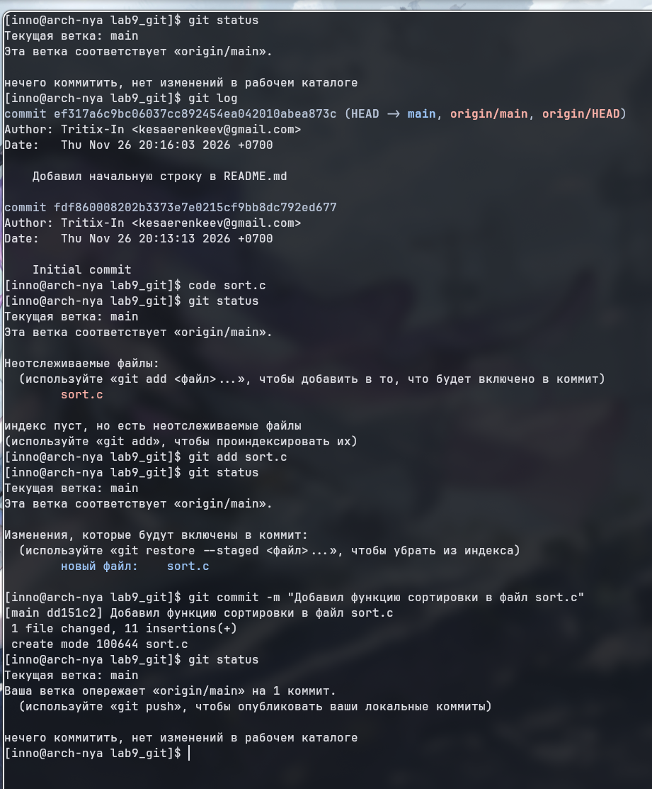
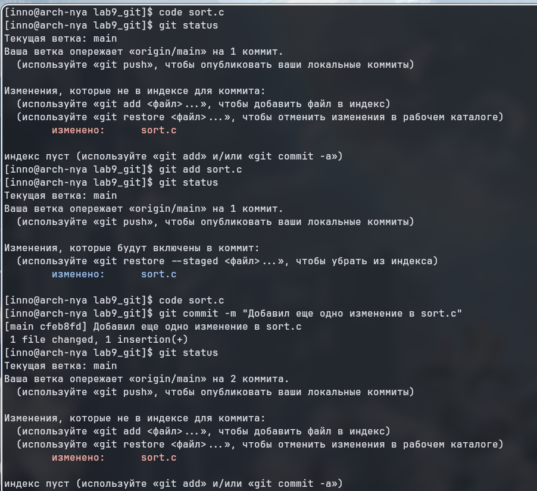
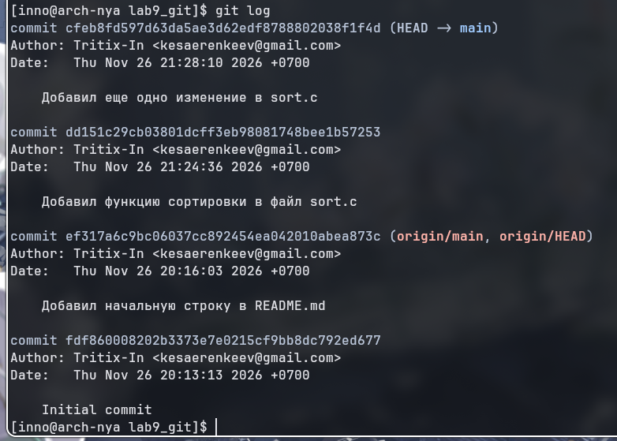
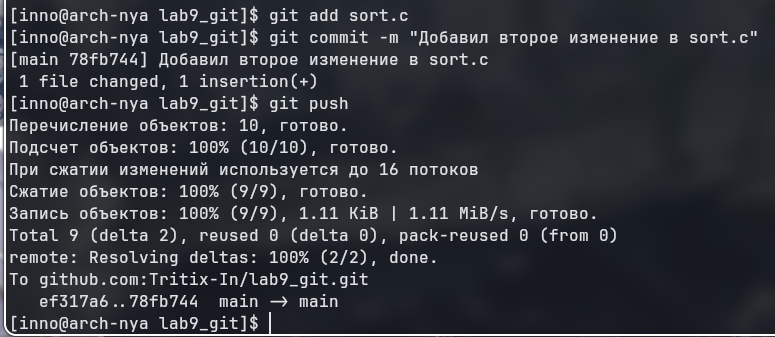

## Ветки 

командой git branch создаем ветку mybranch 

и видем две ветки 

после чего переключаемся на новую ветку через git switch mybranch 

файлы на данный момент одни и те же, нету никаких конфликтов

убеждаемся что мы на ветке mybranch 

создаем файл file1.txt который содержит мое имя 

добавляет в strage и коммитим

git log показывает что mybranch указывает на новый коммит а main на предыдущий

возвращаемся на main

git log показывает что коммит file1.txt исчез и есть только в mybranch

создаем второй файл file2.txt добавляем его в strage и коммитим его 

git lol = git log --oneline --graph --all 

git lol показывает что ветки разошлись и у каждого свои коммиты 

переключаемся на ветку mybranch и видим что файл file2.txt пропал, ведь он существует только на ветке main 

git diff mybranch main показывает разницу что в main есть файл file2.txt но нет file1.txt а в mybranch есть файл file1.txt и нет file2.txt

git push -u origin mybranch этой командой выгружаем все в удаленный репо и создаем там ветку mybranch 

переходим в main и выгружаем в GitHub

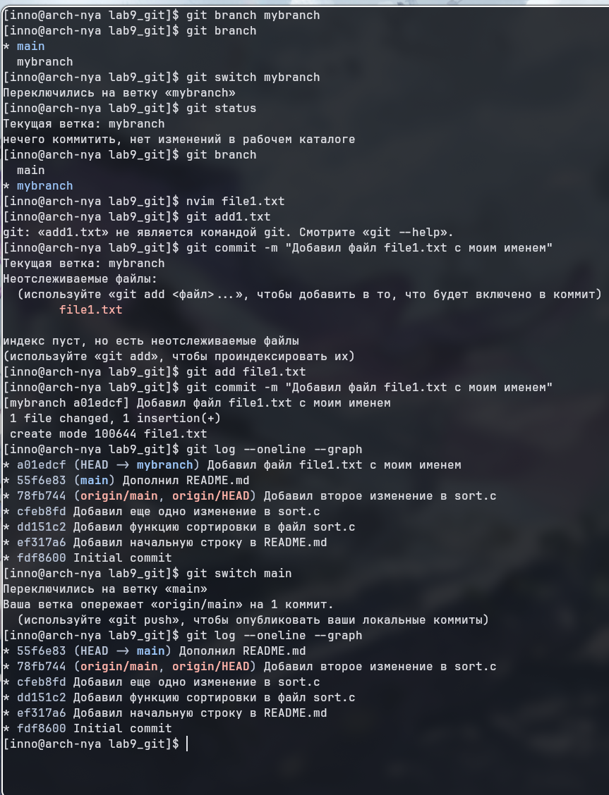
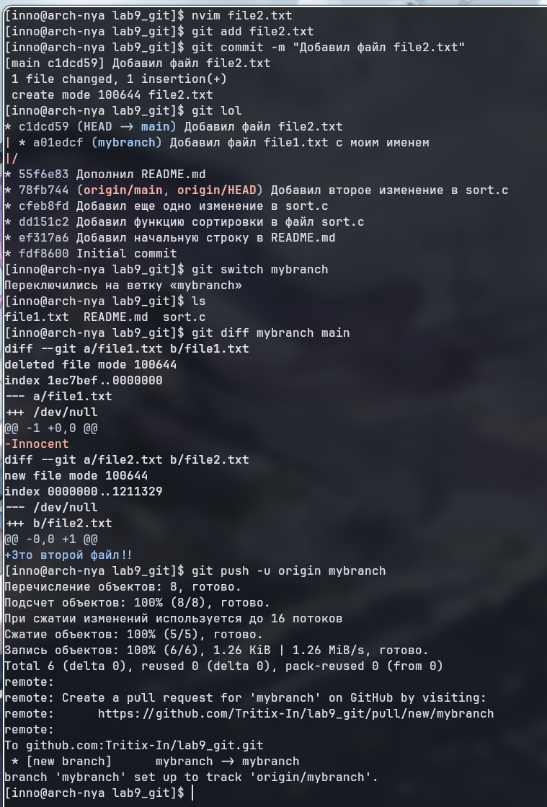
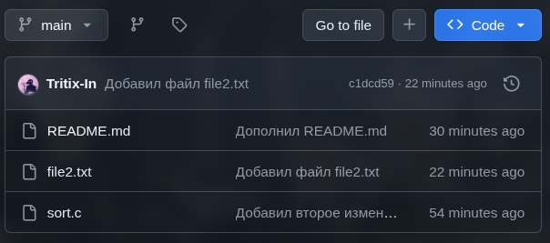
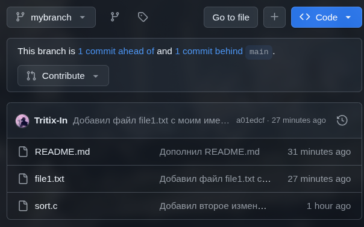

## на оценку 4 

переключаемся на ветку mybranch 

добавляем в файл функцию main который вызывает функцию 

командой git diff видим изменения которые мы произвели в файле а команда git diff --staged ничего не выводит ибо мы не добавили ничего в индекс 

добавляем файл в staged, вызываем git diff и он уже ничего не показывает ведь в рабочей директории ничего не осталось а git diff --staged показывает изменения которые попадут в следующий коммит 

удаляем из массива одно число из массива и смотрим изменения в рабочей директории 

смотрим изменения в индексе и там ничего и там лежит старая версия ведь рабочая директория другая и мы не закоммитили изменения 

git status показывает файл дважды, то что будет изменено и то что не будет изменено 

убираем sort.c из индекса командой git restore --staged sort.c но изменения в рабочей директиве остались 

теперь git status показывает что файл не в индексе и показывает его один раз

добавляем в stage и коммитим

git log показывают новый коммит который мы только что сделали

добавляем printf("...")

и видим что в файле она есть git status показывает изменение 

используем git restore sort.c 

этим мы отменяем изменения в рабочей директории вернув файл к последнему коммиту

а в файле sort.c printf исчез

git status чист нету изменений 

пушим изменения на удаленный git

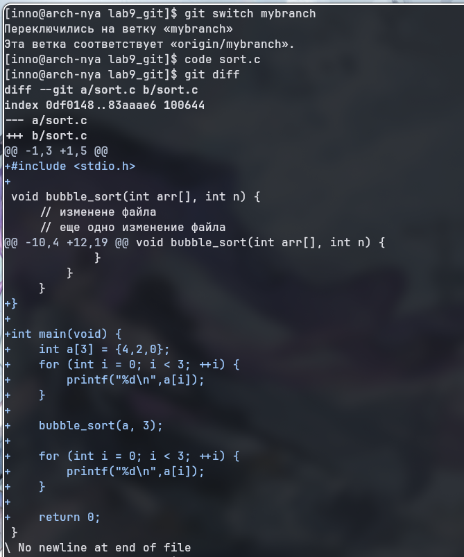
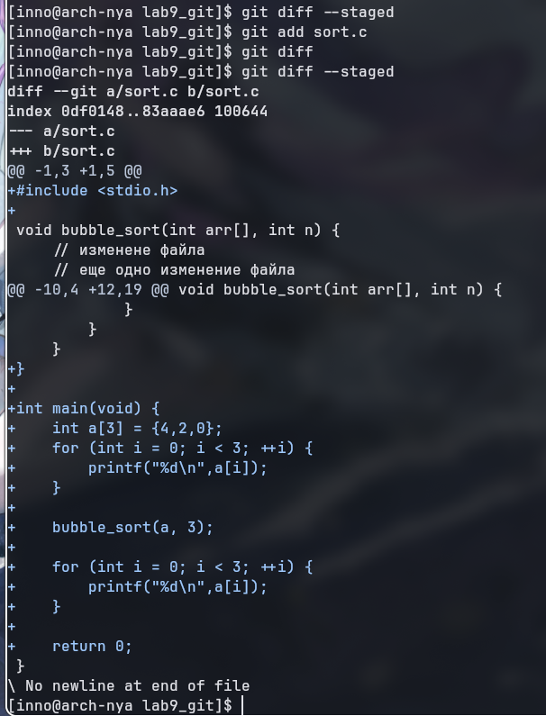
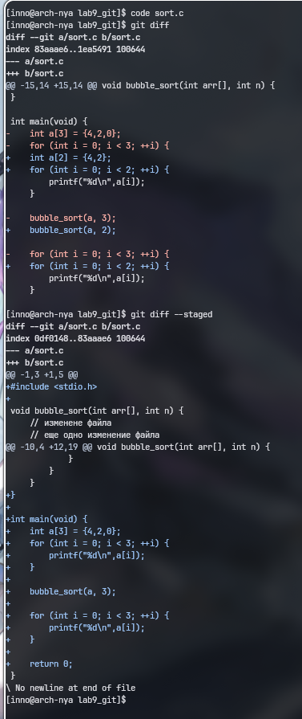
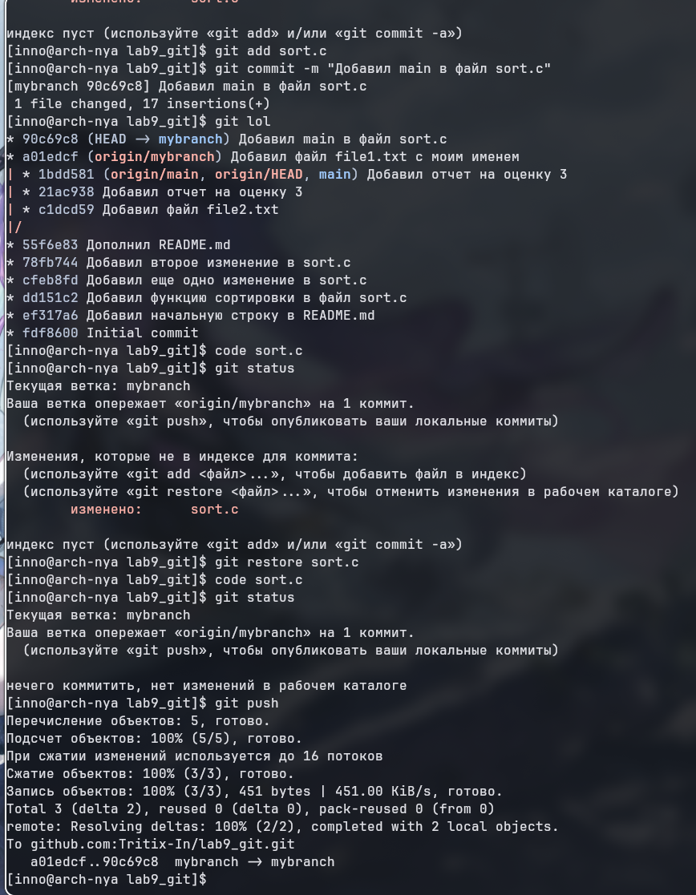

создаем файл greeting.txt 

добавляем в stage и коммитим

добавляем в файл hello добавляем в stage и коммитим

создаем и переключаемся на ветку feature/uppercase

git status показывает что в ветке нет изменений нечего коммитить

отредактируем файл greeting.txt изменив hello на HELLO 

добавляем в stage и коммитим 

git branch показывает что мы на ветке feature/uppercase

git lol показывает, что feature/uppercase на один коммит дальше чем main 

переключаемся в ветку mybranch и видим что там осталась строка hello  

используем git diff mybranch feature/uppercase и видим что в первой ветке hello а во второй HELLO  

git merge feature/uppercase используем для того чтобы провести слияние двух веток(смержить)

теперь в greeting.txt в mybranch HELLO 

удаляем ветку командой git branch -d feature/uppercase

переходим в main и мержим с mybranch

git lol теперь показывает граф с точкой слияния в последнем коммите 

и пушим на удаленный репо 

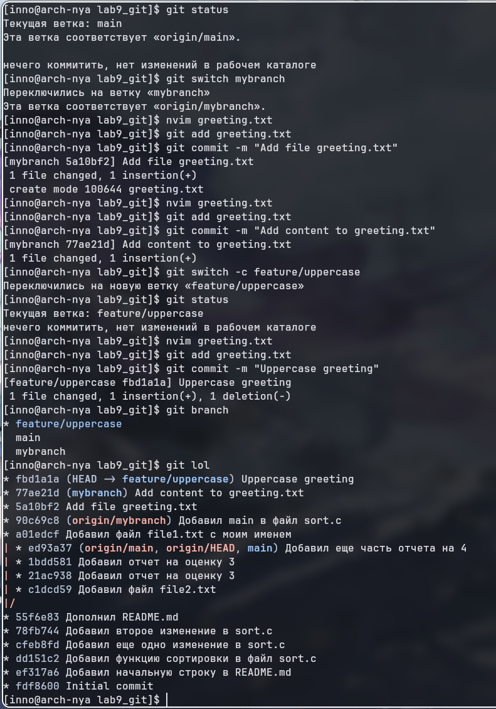
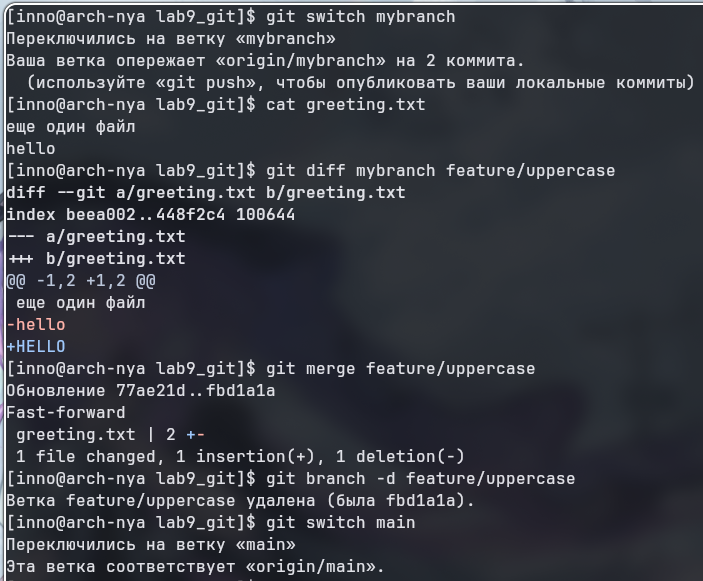
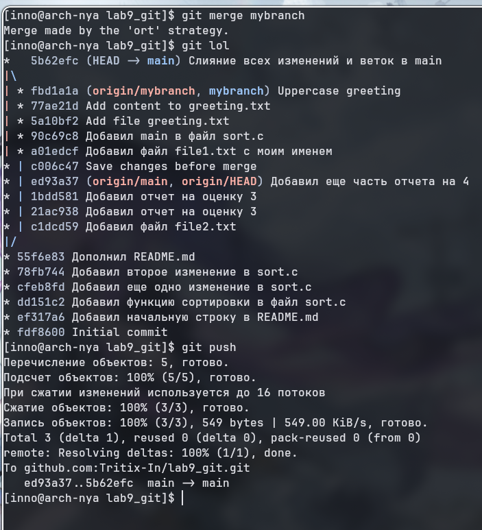

## На оценку 5(часть1)

создаем ветку branch1 и переключаемся на нее 

создаем файл file.txt 

коммитим его 

переключаемся на main и создаем другой file.txt 

коммитим file.txt из main 

используем git lol и видим что ветки разошлись

мержим branch1 в main и получаем конфликт ибо два одинаковых файла содержат разные данные 

статус показывает конфликт 

открываем файл и объеденяем файлы устраняя конфликт 

коммитим файл

используем git log --oneline --graph и видим merge-коммит

пушим 

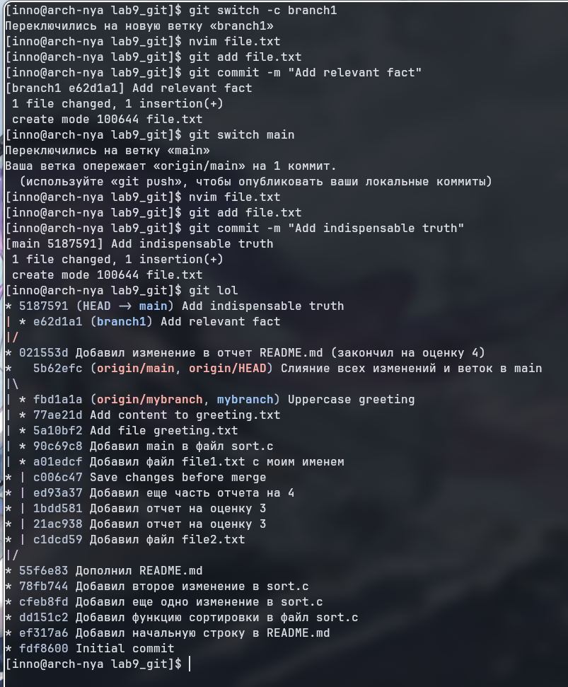
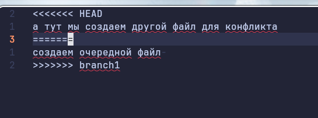
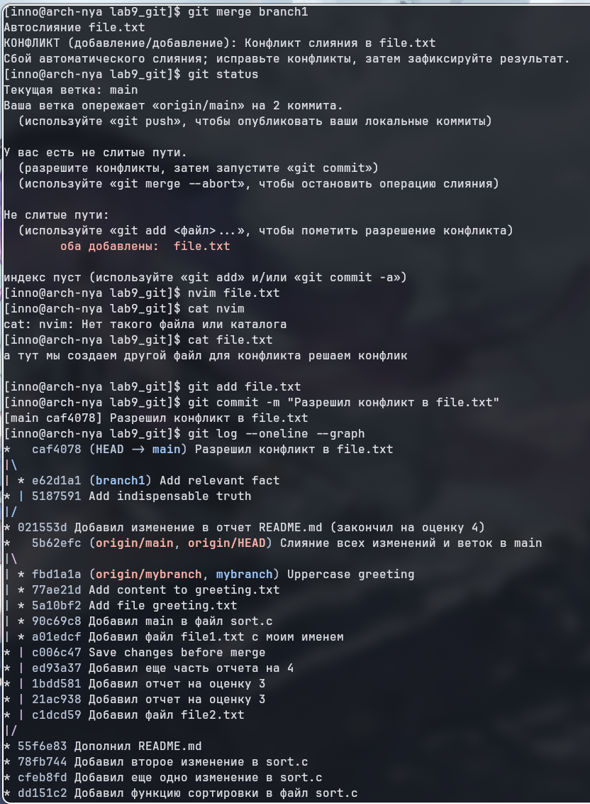

## На оценку 5(часть2)

создаем файл mergesort.py с кодом из base.py 

коммитим этот файл 

создаем ветку Mergesort-Impl

копируем на этой ветке в файл mergesort.py код из righty.py 

коммитим этот файл

переключаемся на main и копируем в mergesort.py код из lefty.py 

коммитим файл в ветке main 

git log --oneline --graph показывает что ветки разошлись 

используем git branch чтобы увидеть все ветки 

мержим Mergesort-Impl в main видим конфликт в ибо два одинаковых файла содержат разные коды 

открываем вс код и выбираем какую из версий оставить 

коммитим файл с решенным конфликтом и пушим на удаленный репо 

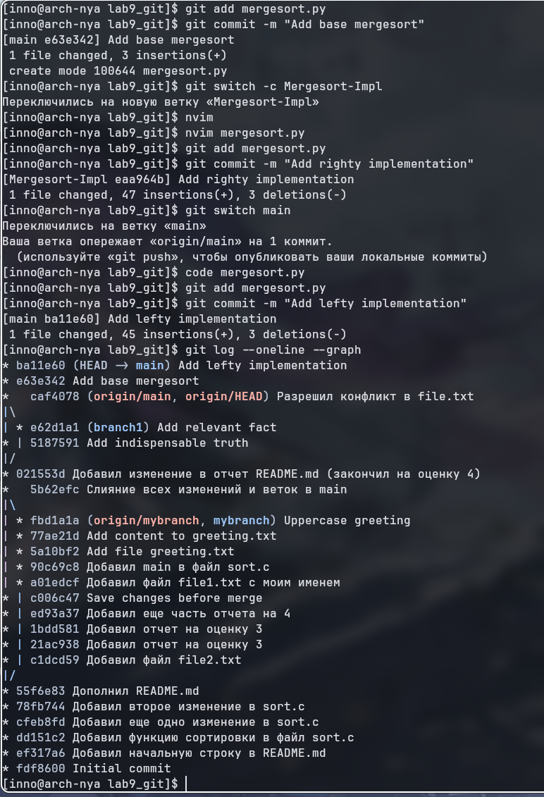
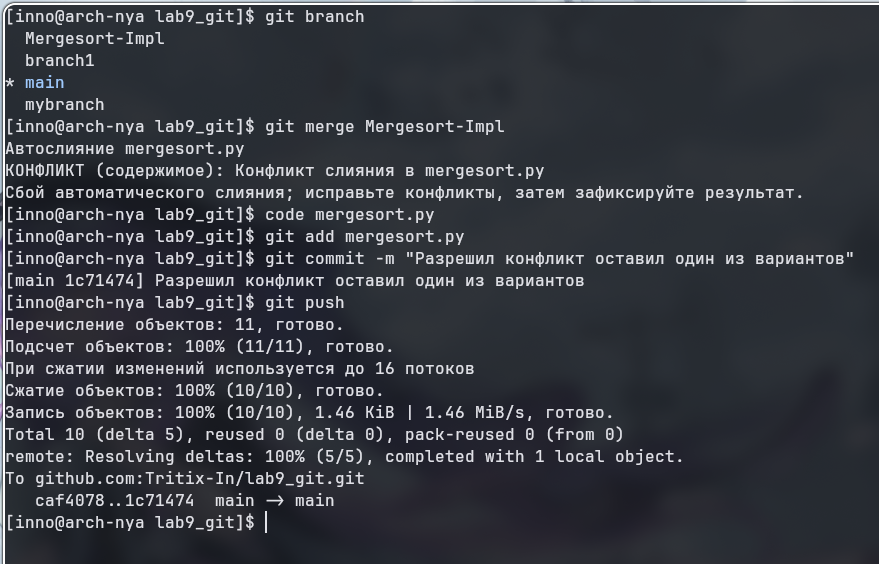

